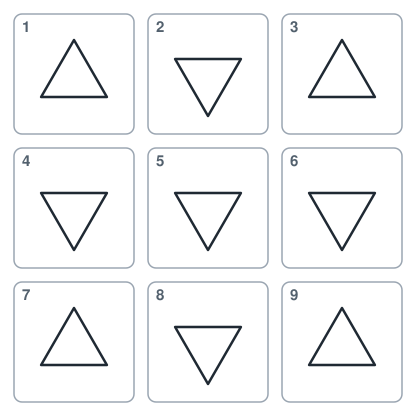
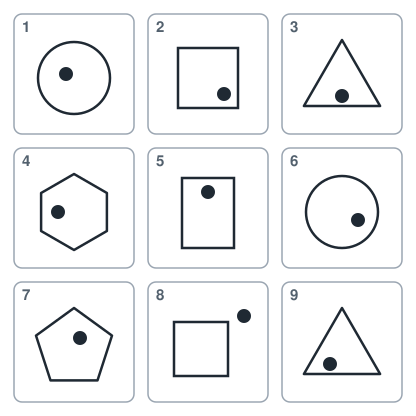

<!-- nav:top -->
[Contents](../README.md#contents) · Previous: [The Aon cut-e scales tests explained](test-overview.md) · Next: [scales numerical](sections/scales-numerical.md)
<!-- /nav:top -->

# 15-minute diagnostic

Six original items, two from each scales test, to show you where to start. Give yourself **4 minutes** for all six, then use the rest of the 15 minutes to read the explanations. Write your answers down before opening any answers block.

These items were written for these notes. They are not taken from Aon or any prep site.

## Part A: scales numerical

Mark each statement TRUE, FALSE or CANNOT SAY using only the table.

**Oakfield Leisure Centre: visits by activity (thousands)**

| Activity | 2024 | 2025 |
|---|---|---|
| Swimming | 84 | 96 |
| Gym | 120 | 132 |
| Classes | 45 | 40 |

**A1.** Gym visits rose by 10% from 2024 to 2025.

**A2.** Fewer different people took part in classes in 2025 than in 2024.

Answers, Part A

**A1: TRUE.** 132 minus 120 is 12, and 12 is 10% of 120.

**A2: CANNOT SAY.** The table counts visits, not people. Class visits fell from 45 to 40 thousand, but the same number of people, or even more, could simply have come less often each. *Why not TRUE:* a fall in visits is not a fall in the number of people.

## Part B: scales verbal

Mark each statement TRUE, FALSE or CANNOT SAY using only the text.

> Kestrel Buses runs 46 routes across the county. In 2025 it replaced 30 of its 120 buses with electric models, paid for partly by a regional grant. Passenger numbers rose by 8% in 2025, and the company has said it will add evening services on its ten busiest routes from next spring.

**B1.** The new electric buses caused the rise in passenger numbers.

**B2.** Kestrel paid the full cost of its new electric buses itself.

Answers, Part B

**B1: CANNOT SAY.** Both things happened in 2025, but the text never links them.

**B2: FALSE.** The buses were "paid for partly by a regional grant", so Kestrel did not pay the full cost.

## Part C: scales ix

Eight of the nine figures follow one rule. Write down the number of the one that does not. Figures run left to right, top to bottom.

**C1.**

**C2.**

Answers, Part C

**C1: figure 5.** The triangles alternate: pointing up, pointing down, up, down. Figure 5 should point up and points down.

**C2: figure 8.** In every figure the dot sits inside the shape. In figure 8 it is outside, above the square's corner.

## What your result means

Count your correct answers in each part.

| Part | 2 correct | 1 correct | 0 correct |
|---|---|---|---|
| A: numerical | Fine. Skim the [numerical guide](sections/scales-numerical.md) traps list. | Read the method and do all 5 items. | Start here. Read the whole [numerical guide](sections/scales-numerical.md) first. |
| B: verbal | Fine. Skim the [verbal guide](sections/scales-verbal.md) traps list. | Read the method and do all 5 items. | Start here. Read the whole [verbal guide](sections/scales-verbal.md) first. |
| C: ix | Fine. Work on speed in the [ix guide](sections/scales-ix.md). | Learn the two rule families, then do all 5 items. | Start here. Read the whole [ix guide](sections/scales-ix.md) first. |

Check your invitation for which tests you were actually sent. Many employers use only one or two of the three. Then follow the [7-day plan](study-plans.md#7-day-plan) or the [2-day plan](study-plans.md#2-day-plan), starting with your weakest part.

If you missed the CANNOT SAY items (A2, B1), that is the most common pattern of all. Both the numerical and verbal guides spend a full step of the method on it.

---

<!-- nav:bottom -->
← Previous: [The Aon cut-e scales tests explained](test-overview.md) | Next: [scales numerical](sections/scales-numerical.md) → | [Back to contents](../README.md#contents)
<!-- /nav:bottom -->
