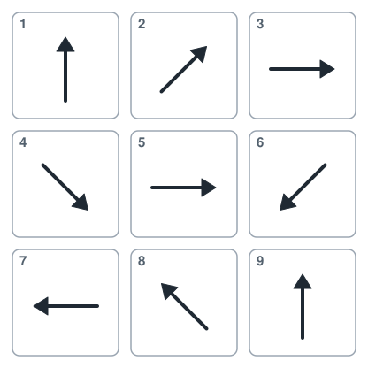
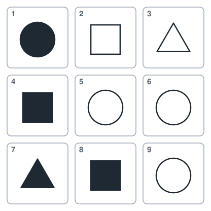
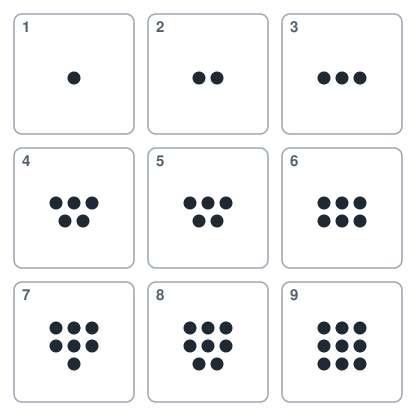
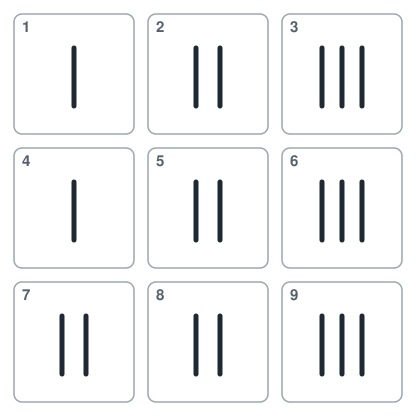
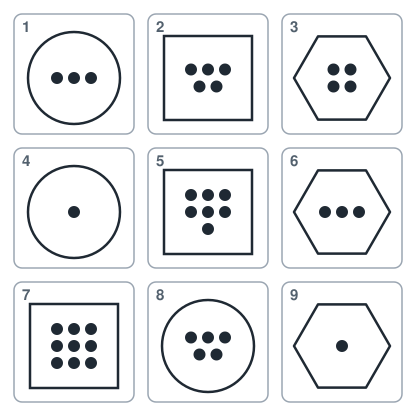
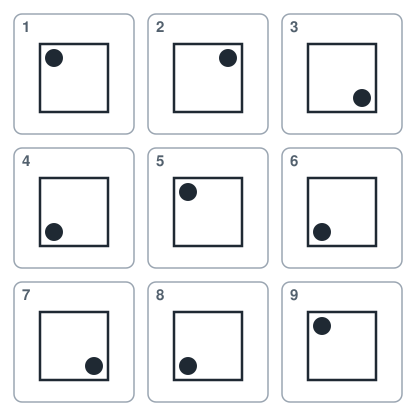
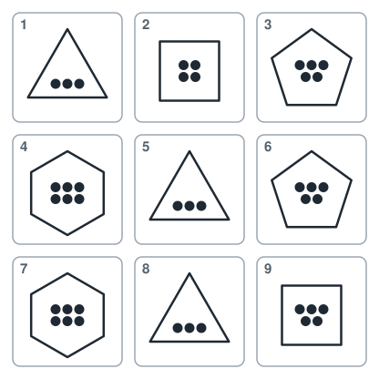
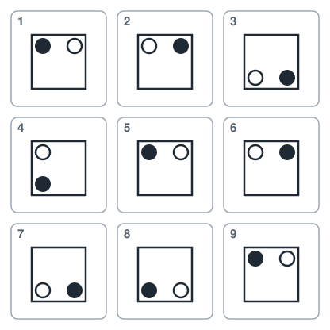
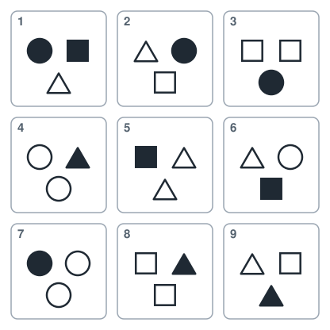
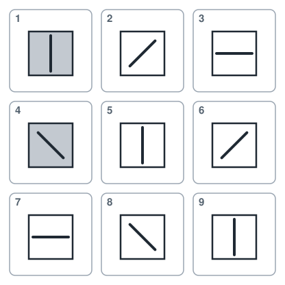

<!-- nav:top -->[Contents](../../README.md#contents) · Previous: [scales verbal](scales-verbal.md) · Next: [How scoring works](../scoring.md)<!-- /nav:top -->

# scales ix (inductive reasoning)

**In one line:** you see nine numbered figures, eight of them follow one hidden rule, and you pick the one that does not.

Aon lists this test as Inductive Reasoning (scales ix): **20 tasks in 5 minutes, finish as many as you can.** Aon's practice document adds that the 20 items come in **increasing order of difficulty**, so the early ones are worth doing quickly and the late ones may not be reachable at all.

## What it measures

Aon describes scales ix as measuring your ability to analyse a situation, work out a rule and apply it. Nothing is spelled out: you have to notice the rule yourself, from examples. That is what "inductive" means here. You go from cases to a rule, then use the rule to spot the case that breaks it.

## How the questions look

One image with nine objects, numbered 1 to 9. Each object follows a governing rule except one, and there is only one correct answer. The rules in Aon's own examples fall into two families, and it helps to name them:

| Family | What it looks like | Typical rules |
|---|---|---|
| **Sequence rules** | The figures change step by step from 1 to 9. | A shape turns by a fixed angle each step. A pattern repeats (one, one, two). Colours alternate. A count goes up by one. Something moves around the frame. |
| **Shared-property rules** | Order does not matter. Every figure has something in common. | Same number of sides. One shape sits fully inside another. An odd number of dots. Exactly one black shape. A count that matches another count in the same figure. |

Harder items stack two rules (for example, a rotation and a colour change), or add things that change at random to distract you, such as shape when the rule is about colour.

## A method that works

1. **Look at figures 1, 2 and 3 first.** Ask: what changes from one to the next? If something changes in a regular way, you are probably looking at a sequence rule.
2. **If nothing changes regularly, look for what all nine share.** Count sides, dots, lines and black shapes. Check positions: inside, outside, touching.
3. **Run one feature at a time.** Shape, size, colour, count, angle, position. Do not try to see everything at once. Most items use one or two features and let the rest vary freely.
4. **Predict, then check.** For a sequence, say what figure 5 should be before you look at it. For a shared property, state it as a sentence ("every figure has an odd number of dots") and test all nine.
5. **Confirm the odd one makes the rest fit.** If removing your pick leaves eight figures that all follow your rule, you have it. If two figures seem to break it, your rule is wrong; go back to step 3.

## Traps that cost points

- **Fixing on a feature that varies at random.** Shape changing from circle to square to triangle can be noise when the rule is about fill. If shape does not follow a pattern, ignore it.
- **Picking the "different-looking" figure.** The odd one out often looks ordinary. The rule decides, not appearance.
- **Stopping after a near-fit.** Check all nine. A rule that fits seven figures is the wrong rule.
- **Misreading direction.** Clockwise versus anticlockwise is a common break. Trace the movement with a finger if it helps.
- **Losing count.** For dots and lines, count twice on the figure you plan to pick. A miscount is the cheapest error to avoid.
- **Spending a minute on item 4.** The early items are the easy marks. If one resists, move on and let the clock work for you.

## Timing

Five minutes for 20 items is 15 seconds each on average, but items get harder as you go. As guidance:

- Aim for well under 15 seconds on the first several items.
- Give the middle items up to about 25 seconds.
- If you cannot name the rule in about 30 seconds, move on. Aon says points are usually added for correct answers and deducted for incorrect ones, so a blind click on a figure you cannot justify is a poor bet.

## Practice items

These 12 items are original, drawn for these notes, and not taken from Aon or any prep site. In each, figures run left to right and top to bottom, from 1 to 9. Eight follow one rule. Write down the number of the figure that does not, then open the explanations.

### Items 1 to 6

**Item 1.**

**Item 2.**

**Item 3.**

**Item 4.**

**Item 5.**

**Item 6.**

Answers and explanations, items 1 to 6

**Item 1: figure 6.** Rule: every figure has exactly four sides. Square, trapezium, rhombus, rectangle, kite, parallelogram and so on all have four. Figure 6 is a pentagon with five. *Shared-property rule:* the order of the shapes does not matter.

**Item 2: figure 5.** Rule: the arrow turns 45 degrees clockwise at each step: up, up-right, right, down-right, then down. Figure 5 points right, which is a turn back anticlockwise. From figure 6 on, the sequence carries on as if figure 5 had pointed down.

**Item 3: figure 8.** Rule: the fill repeats black, white, white. Figures 1 to 6 set the pattern, so 7 is black, 8 should be white and 9 white. Figure 8 is black. *The distractor:* the shapes change with no pattern (circle, square, triangle mixed). Shape is noise here.

**Item 4: figure 4.** Rule: the number of dots goes up by one each step, from 1 to 9. Figure 4 has five dots instead of four. Figure 5 also has five, but that is correct for position 5.

**Item 5: figure 2.** Rule: the small shape sits completely inside the large shape. In figure 2, the small circle crosses the right edge of the square. Every other small shape is fully inside, even when it is off centre (figures 3, 5 and 8). *The distractor:* the outer and inner shapes change freely.

**Item 6: figure 7.** Rule: the number of lines repeats one, two, three. Figures 1 to 6 set the pattern, so figure 7 should have one line. It has two.

### Items 7 to 12

**Item 7.**

**Item 8.**

**Item 9.**

**Item 10.**

**Item 11.**

**Item 12.**

Answers and explanations, items 7 to 12

**Item 7: figure 3.** Rule: every figure holds an odd number of dots (1, 3, 5, 7 or 9). Figure 3 has four. *The distractor:* the frame (circle, square, hexagon) changes with no pattern.

**Item 8: figure 6.** Rule: the dot moves one corner clockwise at each step: top left, top right, bottom right, bottom left, then round again. Figure 5 is top left, so figure 6 should be top right. It is bottom left. Figures 7, 8 and 9 continue correctly from where figure 6 should have been.

**Item 9: figure 9.** Rule: the number of dots inside each shape equals the shape's number of sides: three in a triangle, four in a square, five in a pentagon, six in a hexagon. Figure 9 is a square with five dots. *Shared-property rule:* this one links two features inside the same figure.

**Item 10: figure 4.** Two rules run together. The black dot moves one corner clockwise each step. The white dot moves one corner anticlockwise each step, starting top right. In figure 4 the black dot is correctly at bottom left, but the white dot should be at bottom right and is at top left. Every other figure fits both rules.

**Item 11: figure 1.** Rule: each figure has three shapes, and exactly one of them is black. Figure 1 has two black shapes, the circle and the square. *Why not another:* in every other figure, one shape is black, whatever the shapes are.

**Item 12: figure 7.** Two rules. The line turns 45 degrees clockwise at each step (upright, leaning right, flat, leaning left, then upright again). The background is grey on every third figure, starting with figure 1: figures 1 and 4 are grey, so figure 7 should be grey too. It is white. Its line is correct, so the break is the fill. *Why not another:* the line and the shading follow separate cycles (four steps and three steps), so do not look for a link between them.

## Score yourself

| Item | 1 | 2 | 3 | 4 | 5 | 6 | 7 | 8 | 9 | 10 | 11 | 12 |
|---|---|---|---|---|---|---|---|---|---|---|---|---|
| Answer | 6 | 5 | 8 | 4 | 2 | 7 | 3 | 6 | 9 | 4 | 1 | 7 |

- **11 to 12:** strong pattern spotting. Now do it fast: the real test gives you 5 minutes for 20.
- **8 to 10:** note which family you missed. Sequence misses (2, 3, 6, 8, 12) usually come from not predicting the next figure. Shared-property misses (1, 7, 9, 11) usually come from not counting.
- **7 or fewer:** go through the rules table above and practise naming the family before anything else. "Is it changing step by step, or do they all share something?"

## Next step

Speed matters more on scales ix than on any other scales test. Try the inductive block of the [free Aon cut-e style practice test on PrepClubs](https://prepclubs.com/free-practice-tests/aon-cut-e?utm_source=github&utm_medium=referral&utm_campaign=study-notes&utm_content=aon-cut-e), then come back to the traps list.

---

<!-- nav:bottom -->← Previous: [scales verbal](scales-verbal.md) | Next: [How scoring works](../scoring.md) → | [Back to contents](../../README.md#contents)<!-- /nav:bottom -->
